# SWS405 Unit VII – Lab 01 Report
## Static and Dynamic Malware Analysis Using Kali Linux in UTM

**Name:** `<your name>` | **Student ID:** `<ID>` | **Date:** 18 November 2026
**Module:** SWS405 – Unit VII (7.1 Malware Analysis)

---

## 1. Objective

To analyse a supplied training sample (`suspicious_sample.py`), a harmless ransomware-behaviour simulator, using static techniques (file identification, hashing, strings, hex inspection, YARA) and dynamic techniques (system-call tracing, file-system comparison, network monitoring). Static predictions were then compared with dynamic observations and the findings recorded as training IOCs.

## 2. Environment

| Item | Detail |
|---|---|
| Host / Hypervisor | macOS, UTM (QEMU) |
| Guest OS | Kali Linux, kernel 6.18.12+kali-amd64 |
| Python | 3.14 (seen in strace output) |
| Tools | file, md5sum/sha1sum/sha256sum, strings, xxd, yara, strace, ss, tcpdump |
| Lab directory | `~/SWS405_MalwareLab` |
| Network | UTM Shared Network (NAT), eth0 = 10.0.2.15/24 (see Limitations) |
| Session logging | `script -a session.log` used to record all commands |

> **[Screenshot placeholder – Tool versions]** `file --version`, `yara --version`, `strace --version`
> **[Screenshot placeholder – UTM clone/snapshot taken before the lab]**

## 3. Methodology

1. Took a clean copy of the VM and created a dedicated lab directory.
2. Extracted the ZIP to `/tmp/lab_extract` and copied only the three lab files, leaving the `__MACOSX` metadata behind.
3. **Static analysis:** identified file types with `file`, recorded hashes, extracted strings, inspected the header with `xxd`, and ran the YARA rule. The sample was not executed during this stage.
4. **Dynamic analysis:** recorded a baseline file listing, executed the sample under `strace`, compared the file system before and after, and monitored the network with `ss` and `tcpdump`.
5. Re-verified the sample's SHA-256 to confirm it was not modified.

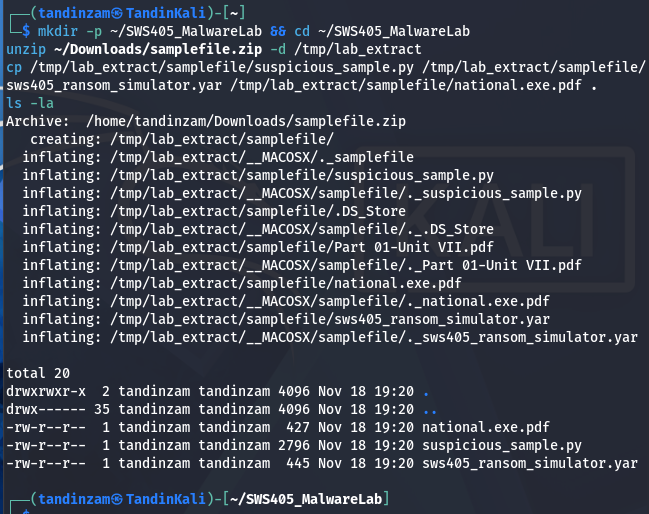

## 4. Static Analysis Findings

### 4.1 File identification
`file` identified `suspicious_sample.py` as *Python script, Unicode text, UTF-8 text executable*. The manual expected "ASCII". The difference comes from an em dash (—) in the script's docstring, a non-ASCII character. The extra file `national.exe.pdf` was identified as a **Python script**, not a PDF or an EXE. Its first bytes are `23 21` (`#!`). It does not contain `%PDF` or the `MZ` signature, so the extension is misleading.

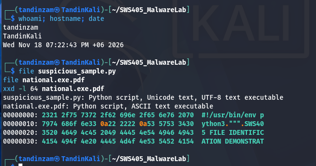

### 4.2 Hashes

| Algorithm | Value |
|---|---|
| MD5 | `29feb123f1f062328b746b1fdb332612` |
| SHA-1 | `b91aa1f51901d2fa48ef83b84c8ef34389ccc10e` |
| SHA-256 | `7ef94bfb15c7479e209a701b40cf6994a2f9c4b0870b4576966b43050554bc26` |

SHA-256 is used as the primary identifier. MD5 and SHA-1 are recorded for compatibility only, because both have known collision weaknesses. `sha256sum -c` returned `OK`.

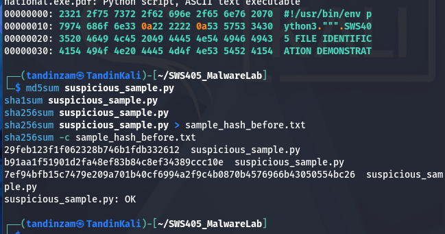

### 4.3 Strings
Suspicious strings found: `SIMULATED_RANSOM_NOTE`, `YOUR FILES ARE LOCKED`, `FILE_CREATE`, `FILE_READ`, `NOTE_CREATE`, `LOG_WRITE`, `lab_workspace`, `victim_files`, `write_text`, `read_bytes`. These suggest that the program creates a folder, writes and reads files, and drops a ransom-note-style file. The keyword "encrypt" appeared only in negated text ("No encryption", "NO FILES HAVE BEEN ENCRYPTED"), so strings have to be read in context. No network-related strings were present (no socket, URL or IP address).

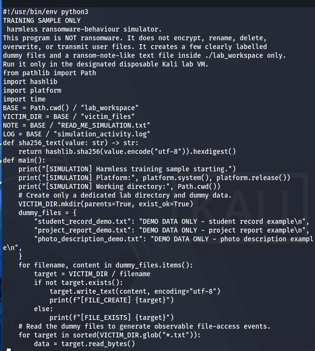
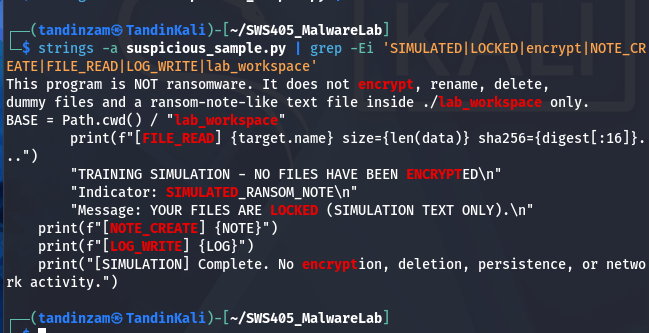

### 4.4 Hex inspection and YARA
`xxd` shows the file begins with `#!/usr/bin/env python3`, so it is a text script, not a PE executable. The bytes `e2 80 94` at offset 0x30 are the UTF-8 em dash, which explains the `file` result above. The YARA rule `SWS405_Harmless_Ransomware_Simulator` matched all three markers: `$marker1` at 0x82f, `$marker2` at 0x85a and `$marker3` at 0xa88. As a negative test, the same rule did **not** match `national.exe.pdf`.

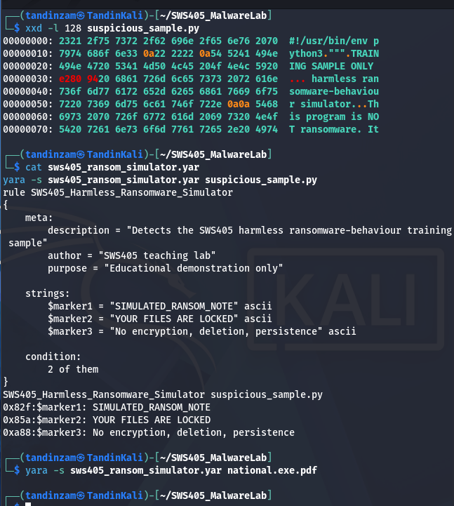

### 4.5 Static analysis worksheet

| Question | Observation | Meaning |
|---|---|---|
| Real file type | Python script, UTF-8 text | Text script, not PE |
| SHA-256 | `7ef94bfb…54bc26` | Unique fingerprint / IOC |
| Suspicious strings | Ransom-note text, FILE_* / NOTE_* / LOG_* markers | Ransomware-like behaviour |
| Suggested operations | mkdir, create/read/write files, note, log | Should appear in strace |
| YARA | Match, 3/3 markers | Known training pattern present |
| Monitor dynamically | File activity in lab_workspace, process, network | Test predictions |

## 5. Dynamic Analysis Findings

### 5.1 Baseline and execution
Before execution, `lab_workspace` did not exist. The sample was run under `strace -f -e trace=%file,%process,%network`. It printed three `FILE_CREATE`, three `FILE_READ`, one `NOTE_CREATE` and one `LOG_WRITE` event, and then completed.

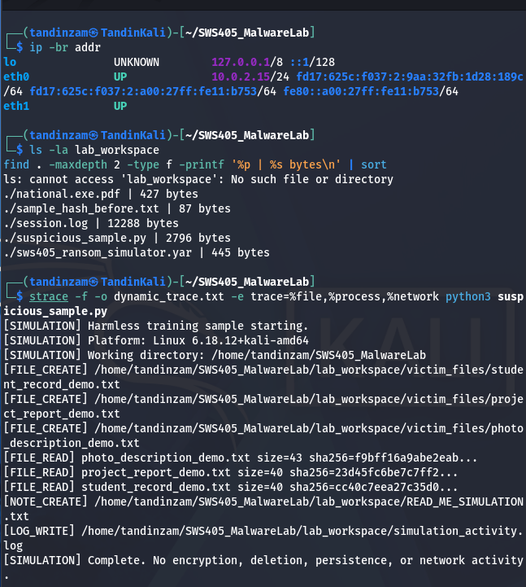

### 5.2 System-call evidence

| System call | Evidence | Meaning |
|---|---|---|
| `execve("/usr/bin/python3", …)` | PID 14168 | Process start |
| `mkdir(…/victim_files) = -1 ENOENT` | then `mkdir(…/lab_workspace) = 0`, `mkdir(…/victim_files) = 0` | Parent created first (`parents=True`) |
| `openat(… O_WRONLY\|O_CREAT\|O_TRUNC)` | 3 victim files, READ_ME_SIMULATION.txt | File creation/write |
| `openat(… O_RDONLY)` | Same 3 victim files | File read |
| `openat(… O_WRONLY\|O_CREAT\|O_APPEND)` | simulation_activity.log | Log append |

The early `ENOENT` results for `pyvenv.cfg` and `._pth` are normal Python start-up lookups, not sample behaviour. The `watch`/`ps` monitor did not capture the process because it finished in under one second. The `execve` record serves as the process evidence instead.

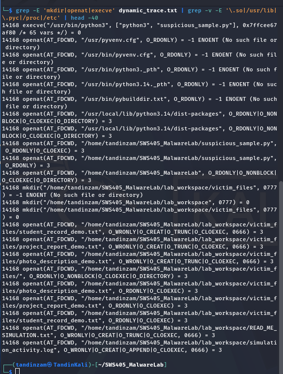

### 5.3 File-system changes
New items after execution: `lab_workspace/`, `victim_files/`, three dummy files (40–43 bytes), `READ_ME_SIMULATION.txt` (254 bytes) and `simulation_activity.log` (71 bytes). The victim files still contain plain "DEMO DATA ONLY" text, and their hashes match the `FILE_READ` output, so **no encryption** took place. The log's `sha256_marker=e60c4ba0c5a5e008` matches the first 16 characters of the note's SHA-256, which links the two artefacts.

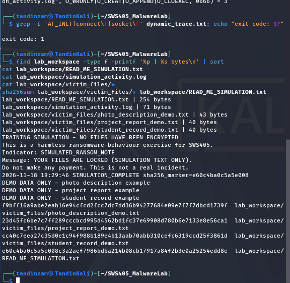

### 5.4 Network
- `grep -E 'AF_INET|connect\(|socket\('` on the trace returned nothing (exit code 1), so there were **no network system calls**.
- The first tcpdump attempt was started *after* the sample had finished, so it does not represent sample activity. It captured 762 packets from one HTTPS session (10.0.2.15:42266 ⇄ 151.101.209.91:443). `ss -tnp` attributed this session to **firefox-esr (PID 3602)**.
- The capture was repeated so that it overlapped a second execution (run 2). It recorded **0 packets**, and filtering out the Firefox host also returned nothing.

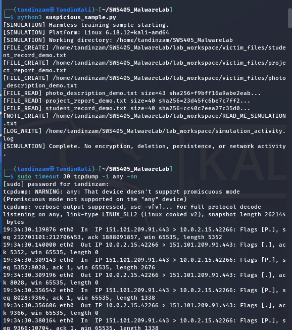
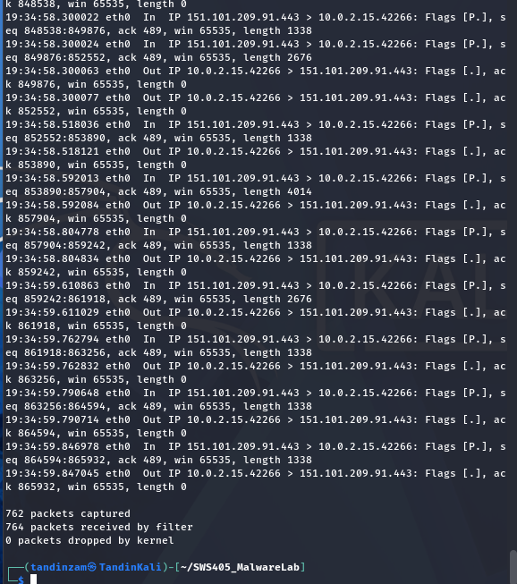
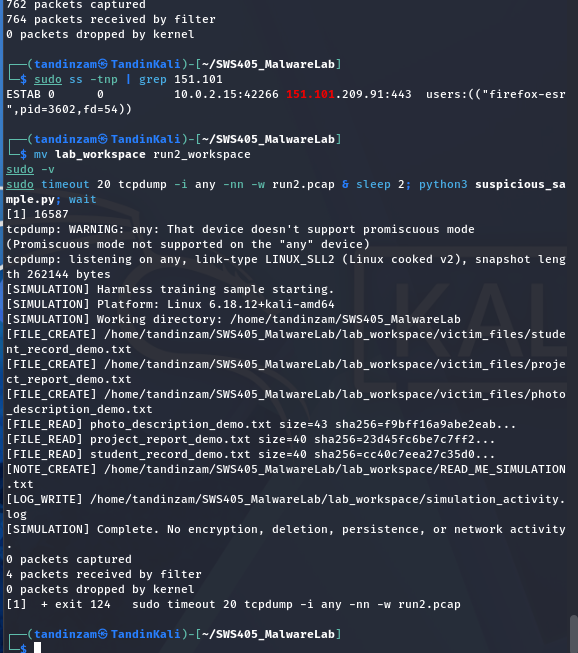
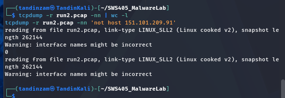

### 5.5 Sample integrity
> **[Screenshot placeholder – `sha256sum -c sample_hash_before.txt` → `suspicious_sample.py: OK` after execution]**

## 6. Static vs Dynamic Comparison

| Static prediction | Dynamic evidence | Conclusion |
|---|---|---|
| FILE_CREATE, lab_workspace strings | `mkdir` + `openat(O_CREAT)` on those paths | Confirmed |
| "YOUR FILES ARE LOCKED" | Present in READ_ME_SIMULATION.txt | Ransom note is simulated |
| File-reading logic | `openat(O_RDONLY)` on victim files | Confirmed |
| No network strings | No socket/connect calls; 0 packets during run | No network activity observed |
| No encryption routine | Victim files unchanged, hashes match | No encryption observed |

## 7. Training IOCs

- **Sample:** `suspicious_sample.py`, Python text script, SHA-256 `7ef94bfb15c7479e209a701b40cf6994a2f9c4b0870b4576966b43050554bc26`
- **YARA:** `SWS405_Harmless_Ransomware_Simulator` (3/3 markers)
- **Directories created:** `./lab_workspace/`, `./lab_workspace/victim_files/`
- **Ransom note:** `./lab_workspace/READ_ME_SIMULATION.txt` (SHA-256 `e60c4ba0c5a5e008…`)
- **Log:** `./lab_workspace/simulation_activity.log`
- **Behaviour:** python3 process; mkdir/openat create, read and append; no network activity

*These are training indicators from a simulator and are not evidence of a real infection.*

## 8. Limitations

- The VM was in **NAT mode, not host-only**, during execution, so internet access was available. The sample made no network calls, but a real sample would have had internet access. Background Firefox traffic was identified with `ss` and excluded.
- The first tcpdump capture did not overlap with execution. This was corrected in run 2, which created a second set of output files (stored separately as `run2_workspace`).
- The sample is a Python script, so PE headers, imports, registry persistence and memory analysis (Volatility) could not be demonstrated.
- Dynamic analysis only shows behaviour in this single environment. Real malware may check for a VM, the time or network access before acting.

## 9. Conclusion

Static analysis predicted file creation, file reading and a ransom-note drop, with no network or encryption capability. Dynamic analysis confirmed every prediction: strace recorded the expected `mkdir` and `openat` calls, the file-system comparison showed only the expected lab artefacts, the dummy files remained unencrypted, and no network activity came from the sample. The sample hash was unchanged after analysis. The lab also showed why an analyst must check each tool's output instead of trusting it blindly. The misleading `.exe.pdf` extension, the negated "encrypt" strings and the unrelated Firefox traffic would all have led to wrong conclusions if accepted at face value.